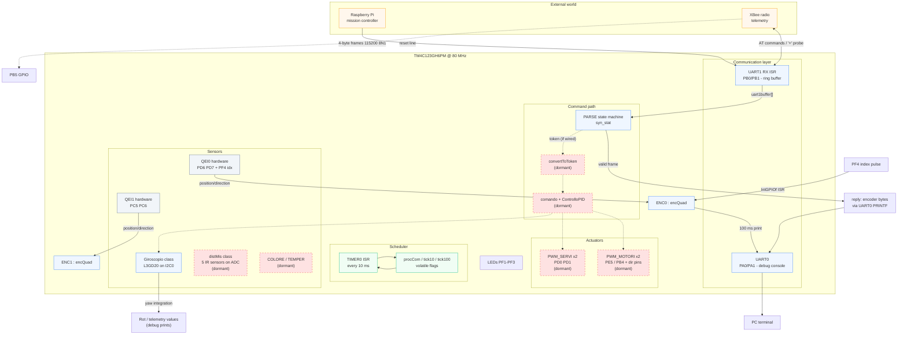
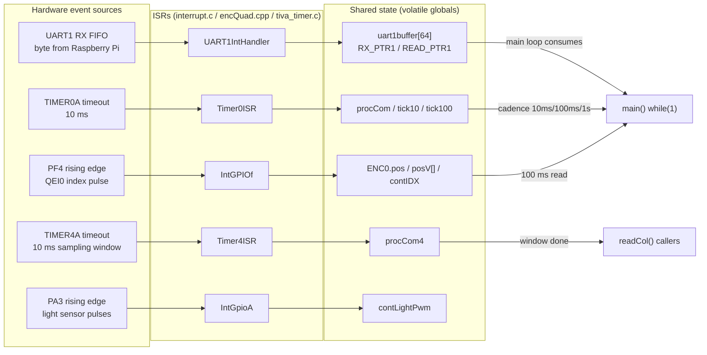
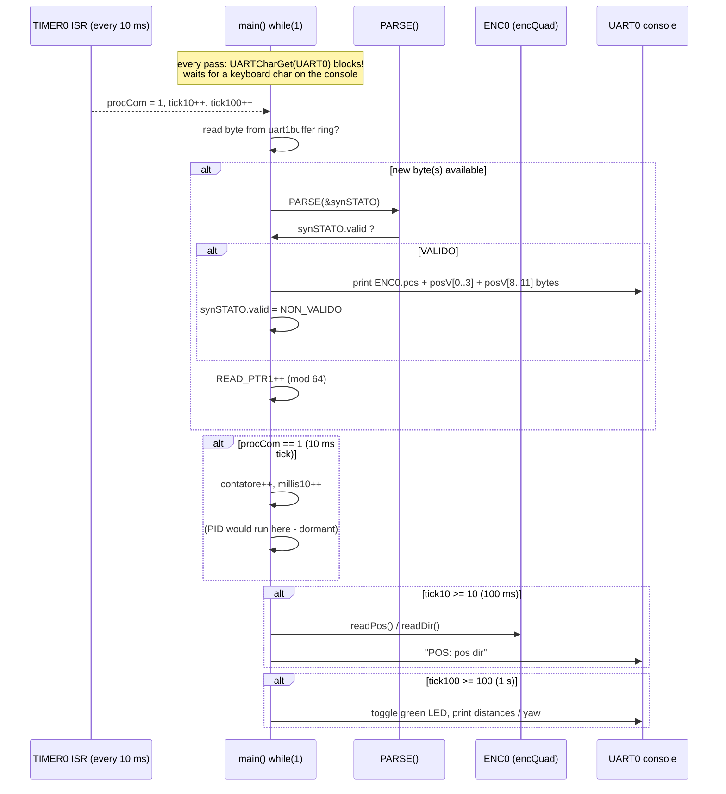
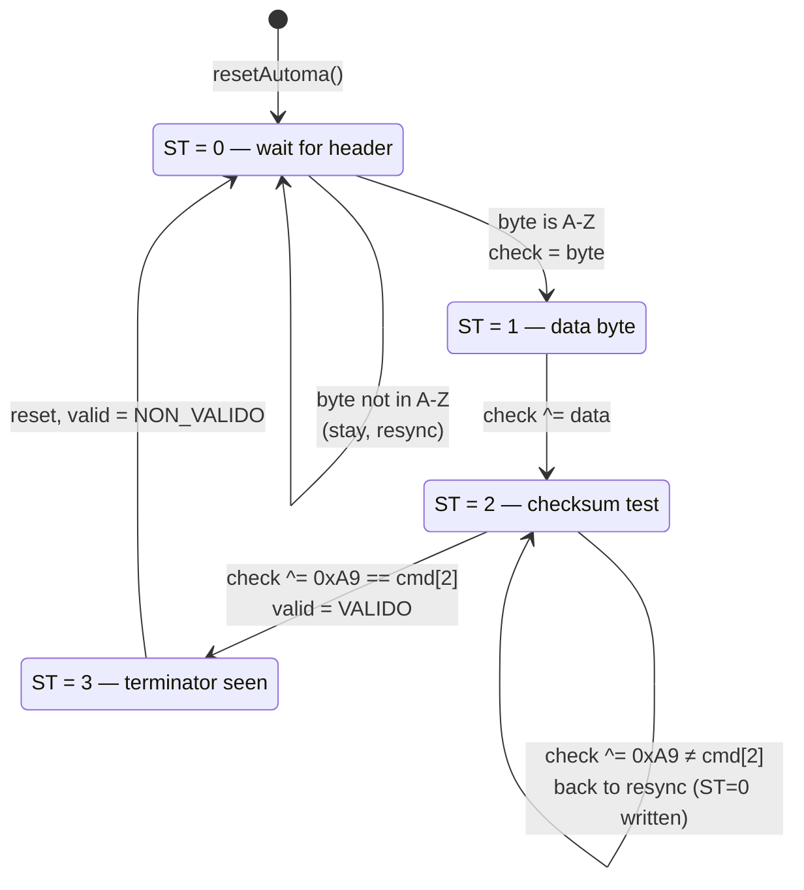
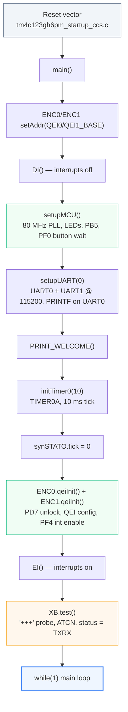

# Architecture — data flow, interrupts and timing

> This page answers the questions *how does a byte travel from the Raspberry Pi to a motor*, and *what happens every 10 ms*. The static object relations are in [class-map.md](class-map.md).

---

## 1. System architecture diagram

Solid blue = live path · dashed red = compiled but unreachable from `main()` in this release.

---

## 2. Interrupt wiring

The interrupt vector table (`tm4c123gh6pm_startup_ccs.c`) binds these handlers:

Points worth noting:

- **Single-producer / single-consumer ring buffers** are used in two places (`uart1buffer` and `ENC0.posV[]`), the classic embedded idiom — see [student-notes.md](student-notes.md#4-ring-buffers-and-the-volatile-keyword).
- `IntGPIOf` (defined in `encQuad.cpp`) is registered **statically** in the vector table, not via `GPIOIntRegister` — the comment lines in `qeiInit` show both approaches were tried.
- `Timer1ISR` and the `QEI0/1IntHandler` pair in `qei.cpp` are **not referenced by the vector table** → dead handlers (see [state-of-code.md](state-of-code.md#2-dead-code-inventory)).
- The UART1 interrupt handler keeps running while XBee `test()` polls the same port — the `'+'` probe and the `OK` answer flow through the same ring buffer, which is why `test()` resets `READ_PTR1/RX_PTR1` first.

---

## 3. Main-loop timeline (one iteration)

⚠️ The first statement inside `while(1)` is `UARTCharGet(UART0_BASE)` — a **blocking** console read. One loop pass happens only per typed character. This is fine on a test bench (you press a key, you see telemetry) but it would starve the rover during a real match. Fix suggestions: [state-of-code.md §6](state-of-code.md#6-bugs-and-fragile-points-summary-table).

---

## 4. The parser state machine

`PARSE()` processes **one byte per call** and advances `STATO->ST` through a 4-state automaton. A frame is `CMD DATA CHECK TERM` (4 bytes):

Verification: `check = header XOR data XOR 0xA9` must equal byte 3. `CHECK_SUM` constant is `0xA9` (`init.h:21`).

Command letters recognised by `convertToToken()` (note: in this release only reachable via the unused twin `parse()`):

| Letter | Token constant | `numPid` | Effect (when wired) |
|--------|---------------|----------|---------------------|
| `F` | `AVANTI` (1) | 0 | both motors forward |
| `B` | `INDIETRO` (2) | 0 | both motors backward |
| `S` | `STOP` (0) | -1 | stop motors |
| `R` | `DESTRA` (3) | 1 | turn right 90° (`valFin -= 90`) |
| `L` | `SINISTRA` (4) | 2 | turn left 90° (`valFin += 90`) |
| `I` | `GIRA_INDIETRO` (5) | unset | 180° spin |
| `G` | `MISURA_GRADI` (10) | — | query angle (not implemented) |
| `D` | `LETTURA_SENSORE` (7) | — | read sensor # (ID in byte 2) |
| `P` | `RILASCIO_PACK` (8) | — | release rescue pack — **falls through to `default`** ⚠ |
| *(other)* | `ERRORE` (255) | -1 | error |

Sensor IDs served by `inviaSensore()` for `D` commands:

| ID | Reading | Source object |
|----|---------|---------------|
| 1–5 | distance mm | `glb.DSTptr->d_mm[0..4]` |
| 6 | yaw | `glb.gyro->yaw` |
| 7 | luminance | `glb.colorClass->luminanza` |
| 8 | temperature | `glb.temperat->Tint` |
| 9 | speed cm/s | hardcoded `1` (placeholder) |
| 10 | travelled distance | `glb.encoder->dist_mm` |
| 11 | accelerometer angle | commented out |

Reply frame: 4 payload bytes + `'*'` terminator (`sendReply()`).

---

## 5. Boot sequence

Details of every step (and the exact registers touched) are in [api-reference.md](api-reference.md).

---

*Next: [class-map.md](class-map.md) for the object view, or [api-reference.md](api-reference.md) for the function-level reference.*
