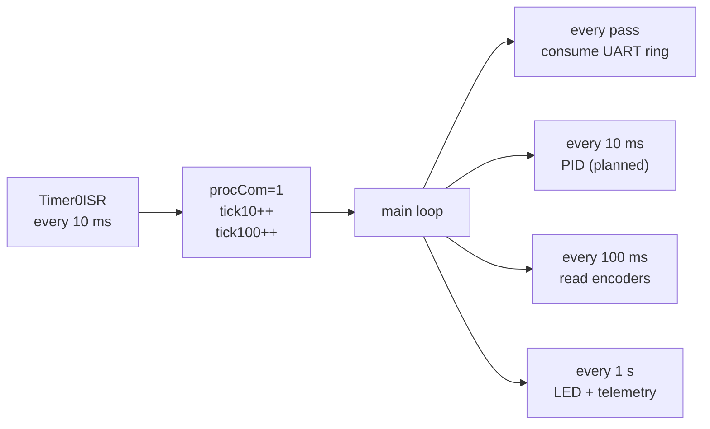

# Student Notes — the embedded concepts behind rigaMagn

> This page turns the codebase into a short course. Each section explains one concept, shows how rigaMagn implements it, and what to learn from it (including what *not* to copy). Prerequisites: basic C. Everything cross-referenced to [api-reference.md](api-reference.md).

---

## 1. Quadrature encoders and the QEI peripheral

**Concept.** A quadrature encoder outputs two square waves, A and B, 90° out of phase. Counting A edges gives *distance*; comparing A vs B phase gives *direction*; a once-per-revolution Index pulse gives an absolute reference.

**In rigaMagn.** The TM4C123 has two *hardware* QEI modules — they count pulses autonomously in silicon, with zero CPU load:

- channels on **PD6/PD7** (QEI0) and **PC5/PC6** (QEI1);
- `QEI_CONFIG_CAPTURE_A` → count A edges only (`QEI_CONFIG_CAPTURE_A_B` would give 4× resolution);
- `fscala` = full-scale counter value (wraps at 40 000);
- a velocity accumulator (`QEIVelocityConfigure`) counts edges per fixed window — configured but never read (`readVel()` is empty).

The interesting pin detail: **PD7 defaults to NMI at reset** and must be "unlocked" before the GPIO mux will hand it to QEI0 — that is the cryptic `UnlockPD7_01()` register dance (encQuad.cpp:32-41):

```c
HWREG(GPIO_PORTD_BASE + GPIO_O_LOCK) = GPIO_LOCK_KEY;  // magic key 0x4C4F434B ("LOCK")
HWREG(GPIO_PORTD_BASE + GPIO_O_CR)   |= 0x80;          // allow rewriting PD7 config
HWREG(GPIO_PORTD_BASE + GPIO_O_PCTL) |= 0x60000000;    // mux PD7 -> QEI0 PHB0
```

**Index pulse handling** is the actual subject of the repo: instead of using the QEI's index-reset mode, the code routes PF4 (index) to a GPIO interrupt and snapshots the counter in software — see the ring-buffer section below.

**Lessons**: hardware peripherals free the CPU; special pins have special unlock procedures (read the datasheet!); capture-mode choice (A vs A&B) changes resolution by 4×.

---

## 2. From angular rate to angle: numeric integration

**Concept.** A gyroscope outputs *angular velocity* (°/s), not angle. To get heading you integrate over time:

```
yaw(t) = yaw(t-Δt) + ω(t)·Δt        (rectangular / Euler rule)
```

**In rigaMagn** (`Giroscopio::misuraAngoli`, Giroscopio.cpp:252-362):

```c
z = raw_reading - z0;                // remove static bias (z0 = calibration mean)
f = z * DPS * kz;                    // raw -> °/s  (DPS = 250/32768, kz = 1.140 empirical)
f *= tick;                           // °/s * s = degrees gained this step
yawF += f;                           // integrate
yaw = (int16_t) yawF;                // integer shadow for the PID
```

Three practical problems the code wrestles with, and you should understand each:

1. **Zero-rate bias (drift)**: even when still, the sensor reads ≠ 0, so the angle slowly runs away. Fix: measure the bias at rest (`azzeraAssi()` averages 128 samples) *and* re-estimate it periodically — every 1000 samples the code compares `yawF` with 10 s ago; if it moved less than 1° it snaps the fractional part back (`yawF = yawP`), otherwise it recalibrates.
2. **Scaling**: the L3GD20 at FS=250 °/s has sensitivity 250/32768 °/s per LSB — plus a hand-tuned correction `kz = 1.140` ("trovato empiricamente", found empirically). Expect such fudge factors in student robots; a proper calibration rig replaces them.
3. **Fixed-point vs float**: `yaw` (int) is what the PID consumes; `yawF` (float) keeps the fraction. On a Cortex-M4F floats are cheap, but the pattern "accumulate in float, export as int" is a classic embedded idiom.

**Why rectangular integration is enough here**: at a 10 ms step and ≤250 °/s rates the error is tiny compared to sensor noise. (Trapezoidal = the code's `0.5·(e[1]+e[0])` trick used in the PID integrator.)

---

## 3. The PID controller

**Concept.** Proportional–Integral–Derivative control: output = `Kp·e + Ki·∫e + Kd·de/dt`, where `e = target − measurement`.

**In rigaMagn** (`ControlloPID::integra`, pid.cpp:44-63):

```c
D = kd * (e[1] - e[0]) / tick;       // derivative (backward difference)
P = kp * e[1];                       // proportional
I = I1 + ki * tick * (e[1] + e[0]);  // trapezoidal integral
I *= 0.50;                           // anti-windup damping (halve accumulator)
I1 = I;
uscita = D + P + I;
if (uscita >  100.0) uscita =  100.0;   // saturation
if (uscita < -100.0) uscita = -100.0;
e[0] = e[1];                         // shift error history
```

Points to study:

- **`e[1]` is the *current* error and `e[0]` the previous one** — the reverse of common textbook naming; read the comments, not convention.
- **Saturation** maps the output to ±100 = PWM duty percent.
- The mysterious `I *= 0.50` each step is a crude anti-windup: it bleeds the integrator so it cannot run away while the motor saturates.
- **The `tipo` dispatch**: `AVANZA` (straight), `RUOTA_DESTRA/SINISTRA` (rotate) — rotation control uses the gyro yaw as feedback (`e = valFin − G->yaw`), which is exactly the integration→control loop of §2.
- **Deadband**: rotation considered done within ±2° (`comando::RUN`), ±1° in the older `Run()`; then `offsetRequest` asks the gyro to re-zero — study how the flag travels PID→gyro.

⚠ Then read [state-of-code.md §1.2](state-of-code.md#1-real-bugs): the gains never reach the members. A perfect example of why you test each unit (this one would show output ≡ 0 immediately).

**Also instructive**: `comando::RUN` shows the *simplified* controller actually used on the bench — fixed duty 65 for straight motion, open-loop spin for rotations. Compare with the commented-out full PID in the same file; the progression "open loop → closed loop" is visible in the sediment.

---

## 4. Ring buffers and the `volatile` keyword

**Concept.** Producer (ISR) and consumer (main loop) exchange data through a circular array with two independent indices. `volatile` tells the compiler a variable may change behind its back — mandatory for anything an ISR touches.

**In rigaMagn**, two textbook-quality examples:

```c
/// (a) UART byte stream — interrupt.c / parse.cpp
volatile uint8_t uart1buffer[64], RX_PTR1, READ_PTR1;
// producer (ISR):        uart1buffer[RX_PTR1] = byte; RX_PTR1 = (RX_PTR1+1) & 63;
// consumer (main loop):  if (READ_PTR1 != RX_PTR1) { PARSE(...); READ_PTR1 = (READ_PTR1+1) & 63; }

/// (b) index-pulse position history — encQuad.cpp IntGPIOf
ENC0.posV[ENC0.indice++] = ENC0.pos;
ENC0.indice &= 63;                     // wrap: 64-slot history of index crossings
```

Study points:

- **`& (N-1)` wrap trick** works only for power-of-two sizes (`DIM_READ_BUFF 64`).
- **Single-producer/single-consumer** means no lock is needed *for the indices* — but note the code also disables interrupts (`DI()`) around multi-byte state in some places, and correctly does *not* here because each side owns exactly one pointer.
- The **event flags** (`procCom`, `tick10`, `tick100`) set by `Timer0ISR` and polled in the main loop are the same idea one level up: a 1-element buffer. The whole scheduler is "ISR writes flag, main loop consumes and clears" — the simplest cooperative scheduler that can exist.
- Contrast with the blocking call right above it (main.cpp:181) — one line of `UARTCharGet` defeats the entire non-blocking design. A good exercise: identify *why* the ring buffer still works in practice on the bench (answer: the Raspberry Pi stream pauses while nobody types, so no bytes are lost — but any real-time sensor stream would corrupt).

---

## 5. Command parsing: framing, checksums and state machines

**Concept.** Serial protocols need (1) framing (where a message starts/ends), (2) integrity (checksum), (3) resynchronisation after noise. A per-byte state machine is the standard embedded answer.

**In rigaMagn** (`PARSE`, parse.cpp:36-93): frame = `HEADER(A–Z) DATA CHECK TERM`, with `CHECK = HEADER ⊕ DATA ⊕ 0xA9`. The automaton is documented with a state diagram in [architecture.md §4](architecture.md#4-the-parser-state-machine).

Design choices worth discussing:

- **Uppercase letters** as header makes the header self-delimiting: any noise byte < 'A' or > 'Z' resets to ST0. Cheap and robust.
- **XOR checksum** catches any odd number of bit flips; adding the magic constant `0xA9` guards against an all-zero frame passing.
- **Errors do not change the vehicle state** — the author's comment (parse.cpp:41-43) is explicit: a bad frame must never stop an in-progress manoeuvre. This is a real robotics policy (imagine the Pi's radio glitching mid-rotation).
- The reply direction uses the same checksum scheme (`rispondiComando`, XOR over 3 bytes + `0xA9`) plus a `'*'` terminator.
- ⚠ The `case 'P'` fall-through (state-of-code §1.1) is a state-machine bug that a *table-driven* parser (array of `{letter, token, numPid}`) would have made impossible. Try rewriting it as a table exercise.

---

## 6. Cooperative scheduling with one timer

**Concept.** No RTOS here: one 10 ms hardware timer produces tick flags; the super-loop demultiplexes them into slower rates.



- 10 ms (`procCom`) → control loop rate (matches `Giroscopio::tick` integration step and `vel_period`).
- 100 ms (`tick10 >= 10`) → encoder snapshot + print.
- 1 s (`tick100 >= 100`) → heart-beat LED (`GPIO_PIN_3 ^= ...`) and slow telemetry.
- `attesa(int)` (gyro_init.c:236) shows the complementary primitive: sleep N ticks by polling `procCom`.

**Discussion**: what breaks if one cadenced block takes > 10 ms? (The loop *lags* but the ticks keep counting — with this polling scheme it self-corrects, but latency jitter appears; a proper scheduler would skip missed slots. Bonus: the `Timer1ISR` comment at tiva_timer.c:47 shows the author already thinking about this.)

---

## 7. Reading datasheet registers: the L3GD20 walk-through

`Giroscopio` is a compact case study in driving an I2C sensor:

1. **Identification**: read `WHO_AM_I` (0x0F), expect `0xD4` (Giroscopio.cpp:170).
2. **Enable**: write `CTRL_REG1 = 0x08 | axes` — bit 3 = power-on, bits 0-2 = axis enables; read back and verify (write-then-verify pattern, line 219).
3. **Range**: `CTRL_REG4 = FS_250` → sensitivity 250/32768 °/s/LSB.
4. **Data ready**: poll `STATUS_REG` (bit `ZYXDA`) before reading — the code polls it as != 0.
5. **Multi-byte read**: set the auto-increment bit (`MUL_READ 0x80`) on the register address and burst-read 2 or 6 bytes (`I2CReceiveN`) — prevents the value tearing between the L and H bytes.
6. **Little-endian assembly**: `(int16_t)((buffer[1] << 8) + buffer[0])`.

The **dual-path I2C** design (`i2cPtr == NULL ? raw API : class API`) is dependency injection done by hand — a good stepping stone to understanding why embedded codebases adopt (or avoid) such patterns.

---

## 8. Tiva-specific idioms

- **GPIO data register aliasing**: reads/writes go to `GPIO_PORTF_BASE + GPIO_O_DATA + (pin << 2)` — bits 9:2 of the address mask which pins are affected (`HWREG(...)` throughout `setupMCU`). This is why every pin constant appears shifted left by 2.
- **ROM functions**: `ROM_SysCtlClockSet(...)` call routines burned in the MCU's ROM, saving flash and guaranteeing a base driver set. Mixed `ROM_x`/`x` calls in the same file work but are stylistically inconsistent.
- **`HWREG(addr)`**: direct 32-bit register access macro — the "I know what I am doing" escape hatch.
- **FPU lazy stacking** (`ROM_FPULazyStackingEnable`, tiva_timer.c:82): lets ISRs use floats without saving the FPU context unless actually needed — latency vs stack trade-off, worth reading about.
- **Interrupt priorities**: `ROM_IntPrioritySet(INT_GPIOF, 0x00)` = highest; on Cortex-M *lower number = higher urgency*. The encoder index and light-sensor pulses are time-critical; UART bytes are buffered by hardware FIFO, so they tolerate delay.

---

## 9. Project archaeology: reading an evolved codebase

rigaMagn is a perfect specimen of **stratified student code** — three eras visible at once:

- **2015 C-era**: pointer-struct APIs (`qei`, `gyro`, `pwm` structs), `dati` pointer bags, comments in full sentences.
- **2015-16 C++-era**: classes with constructors (`encQuad`, `Giroscopio`, `PWM_MOTORI` with static auto-numbering).
- **Test-release era**: the current `main`, with the full rover machinery dormant (see [state-of-code.md §4](state-of-code.md#4-the-disconnected-command-path)).

Skills this README set trains: identifying dead code by **call-graph reachability** (not by grep), recognising duplicated logic and its "which one wins" answer, and using header comments + git history (`git log --follow`) to date each layer. The [class-map.md](class-map.md) duplication table is exactly the artefact you should produce before refactoring any legacy project.

---

## 10. Suggested exercises

1. **Fix the three functional bugs** ([state-of-code §1](state-of-code.md#1-real-bugs)) and write a unit justification for each fix.
2. **Rewrite `convertToToken` as a lookup table** and show the `P` bug becomes structurally impossible.
3. **Simulate the parser**: write a host-side C program feeding byte streams (valid, noisy, split-across-rings) into `PARSE` and assert the state transitions.
4. **Close the control loop**: wire `comando::RUN` into the 10 ms block per [state-of-code §7](state-of-code.md#7-suggested-re-activation-plan) and log `yaw` vs `valFin` on UART0 to plot the step response.
5. **Measure drift**: run `Giroscopio::misuraAngoli` for 10 min at rest, log `yawF`, quantify °/min drift before and after the 10 s auto-compensation.
6. **Ring-buffer stress test**: at what UART baud / burst length does the 64-byte ring overflow given the (buggy) blocking loop? Compute and then demonstrate.
7. **Port the parser to a host test harness** and get it under a CI unit-test runner — the module is already pure logic; this is the easiest production-grade improvement.

---

*Back to [index.md](index.md) · diagrams in [architecture.md](architecture.md) · objects in [class-map.md](class-map.md) · reference in [api-reference.md](api-reference.md)*
