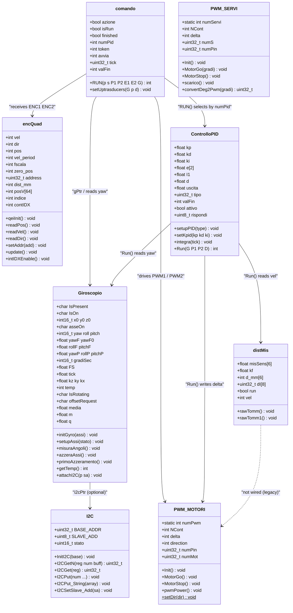
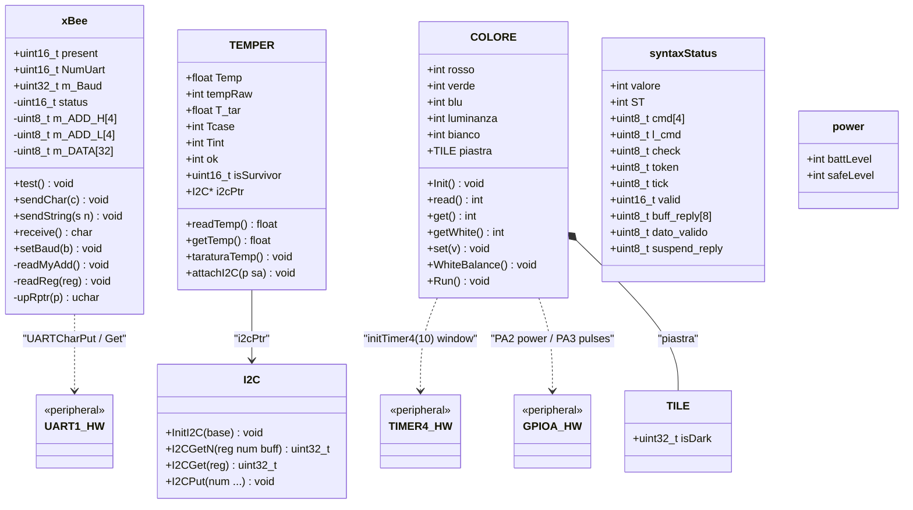
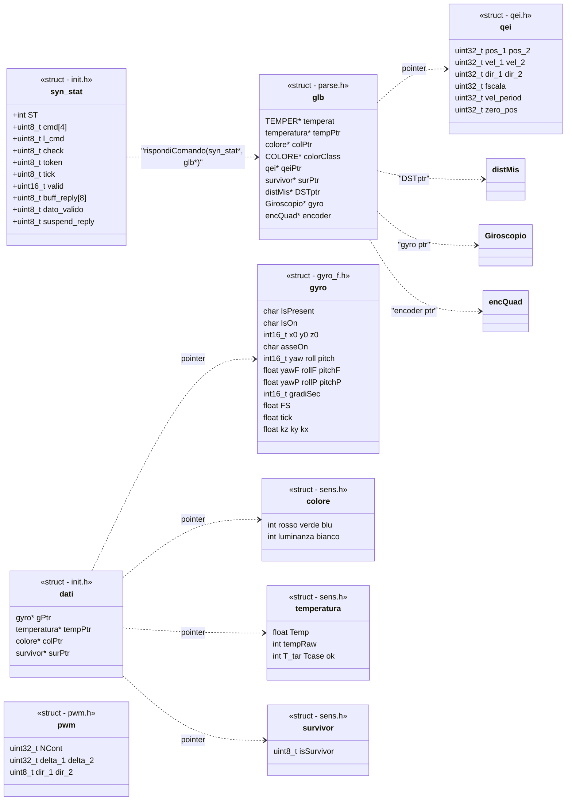

# Class Map — classes, structs and their relations

> This page is the **object map** of rigaMagn. Two views are given: (a) the C++ class hierarchy as UML diagrams, (b) the legacy C structs that coexist with them, and (c) the concrete objects (global variables) and their wiring. Function-by-function detail lives in [api-reference.md](api-reference.md).

---

## 1. The C++ classes — motion & control subsystem

**How to read this**: `comando` is the *behaviour* object (what to do), `ControlloPID` is the *regulator* (how to do it), `encQuad`/`Giroscopio`/`distMis` are *sensors*, `PWM_MOTORI` is the *actuator*. The dashed link marks a dependency that exists in the original design but is not wired in this release.

---

## 2. The C++ classes — communication & I/O subsystem

`power` and `syntaxStatus` are **orphans** in this release: `power` is never instantiated, and `syntaxStatus` duplicates the C struct `syn_stat` (which is the one actually used by `main`). See [state-of-code.md](state-of-code.md#3-duplicate-and-parallel-implementations).

---

## 3. The legacy C structs

The project evolved from a pure-C codebase; the old structs still share the header files with the classes that superseded them.

**Struct ↔ class duplication map** (old → new):

| Legacy C struct | Superseded by C++ class | Status in this release |
|---|---|---|
| `gyro` (gyro_f.h) | `Giroscopio` | struct still included everywhere; class is the active one |
| `qei` (qei.h) | `encQuad` | whole `qei.cpp` compiles but is never called from `main` |
| `pwm` (pwm.h) | `PWM_MOTORI` | struct referenced by legacy prototypes only |
| `colore` / `temperatura` / `survivor` (sens.h) | `COLORE` / `TEMPER` | structs survive inside `dati`/`glb` pointer bags |
| `syn_stat` (init.h) | `syntaxStatus` (parse.h) | **struct wins**: `main` uses `syn_stat`; the class is instantiated once and ignored |

---

## 4. Object inventory — the concrete instances

These are the actual objects created at runtime (all file-scope globals or locals in `main()`):

| Object | Type | Scope | Created in | Purpose |
|--------|------|-------|-----------|---------|
| `ENC0` | `encQuad` | global (`main.cpp:66`) | static | left/right encoder on **QEI0**, also written by ISR `IntGPIOf` |
| `ENC1` | `encQuad` | global (`main.cpp:66`) | static | second encoder on **QEI1** (never read in main loop) |
| `synSTATO` | `syn_stat` | local in `main()` | stack | parser state machine state |
| `CMD1` | `comando` | local in `main()` | stack | current command descriptor (token, numPid, tick...) |
| `XB` | `xBee` | local in `main()` | stack | radio module; `test()` probes presence at boot |
| `synStat` | `syntaxStatus` | local in `main()` | stack | **dead** — declared, never used |
| `uart1buffer[64]`, `RX_PTR1`, `READ_PTR1` | `volatile uint8_t` | global (`interrupt.c:28`) | static | UART1 receive ring buffer shared ISR ↔ main |
| `procCom`, `tick10`, `tick100`, `millis10` | `volatile int` | global (`main.cpp:59`) | static | scheduler flags set by `Timer0ISR` |
| `procCom4` | `volatile int` | global (`main.cpp:60`) | static | TIMER4 window-done flag (light sensor) |
| `contLightPwm` | `volatile int` | global (`interrupt.c:63`) | static | light pulse counter (`IntGpioA`) |
| `p` (in qei.cpp) | `qei*` | global (`qei.cpp:30`) | static | **never initialized** — NULL pointer risk |

Note the symmetric pattern: **encoders and sensors are globals; orchestrators (`synSTATO`, `CMD1`, `XB`) are stack locals of `main()`**. ISR code can only safely touch the globals — which is exactly what `IntGPIOf` does with `ENC0`.

---

## 5. Who-calls-whom: the relation matrix

Relations between the main actors (✅ = actually executed in this release; 🔶 = compiled but unreachable from the current `main()`; ⛔ = would crash if executed):

| Caller ↓ / Callee → | `PARSE` | `convertToToken` | `encQuad` methods | `Giroscopio` methods | `comando::RUN` | `PWM_MOTORI` | `xBee::test` | `sendReply` |
|---|---|---|---|---|---|---|---|---|
| `main()` loop | ✅ | 🔶 (only via `parse()`) | ✅ `readPos/readDir` | 🔶 | 🔶 | 🔶 | ✅ | 🔶 |
| `PARSE()` | — | 🔶 | — | — | — | — | — | — |
| `parse()` (unused twin) | — | ✅ | — | — | — | — | — | — |
| `comando::RUN` | — | — | 🔶 (params only) | 🔶 | — | 🔶 | — | — |
| ISR `IntGPIOf` | — | — | ✅ writes `ENC0` fields | — | — | — | — | — |
| ISR `UART1IntHandler` | — | — | — | — | — | — | — | — |
| `rispondiComando` | — | — | — | — | — | — | — | ✅ |
| `inviaSensore` | — | — | — | 🔶 reads `Giroscopio::yaw` | — | — | — | via caller |

Key takeaway: **the live data path is much narrower than the compiled code** — parser → (no token) → encoder reply, and ISR → `ENC0`. Everything else is dormant scaffolding, ready to be re-connected (the plan for that re-connection is documented in [state-of-code.md](state-of-code.md#7-suggested-re-activation-plan)).

---

*Next: [architecture.md](architecture.md) explains when these calls happen in time; [api-reference.md](api-reference.md) documents each one in detail.*
