# rigaMagn — Documentation Hub

> **rigaMagn** — firmware that counts pulses of a quadrature magnetic encoder on a TI **TM4C123GH6PM** (Tiva C) microcontroller.
> Code by Massimo Zandri (mzandri), written ~2015–2016, last commit May 2016. License: CC0-1.0.
> This documentation was reconstructed in 2026 from the sources on GitHub, ten years later, as a study and recovery aid.

---

## 📚 How to navigate (hypertext)

| Page | What you will find |
|------|--------------------|
| **index.md** (this page) | Project at a glance, repository map, hardware context, glossary |
| [architecture.md](architecture.md) | System architecture, peripherals wiring, interrupt flow, main-loop timeline, command protocol |
| [class-map.md](class-map.md) | **Class maps**: UML diagrams of every class/struct, object inventory, who-calls-whom relations |
| [api-reference.md](api-reference.md) | Full reference: every class, struct, function and ISR, file by file, with code excerpts |
| [state-of-code.md](state-of-code.md) | Code review after 10 years: bugs, dead code, inconsistencies, suggested cleanup |
| [student-notes.md](student-notes.md) | Educational notes: QEI, PID, gyro integration, ring buffers, `volatile`, embedded idioms |

Suggested reading order for students: **index → architecture → class-map → student-notes → api-reference → state-of-code**.

---

## 1. Project at a glance

The repository contains the **embedded firmware of a small differential-drive rover** built for *RoboCup Junior Rescue*-style competitions. The board talks to a **Raspberry Pi** over a serial line: the Pi sends 4-byte movement/query commands, the Tiva executes them with PID-based motion control and reports sensor readings back.

The README title ("counts pulses of a quadrature magnetic encoder") describes the *test-bench focus* of this particular release: the main loop mostly exercises the two hardware QEI modules and streams encoder readings over the debug console, while the full command/PID machinery is present but only partially wired.

| Aspect | Value |
|--------|-------|
| MCU | TI TM4C123GH6PM (ARM Cortex-M4F, 80 MHz) |
| Language | C (47%) + C++ (42%) — a mixed legacy style typical of evolving prototypes |
| IDE / toolchain | TI Code Composer Studio 6, ARM compiler 5.1.6 |
| Vendor library | TivaWare C Series 2.1.0.12573 (driverlib) |
| Build system | CCS-generated makefiles in `Release/` (Windows `cmd.exe` shell, paths to `C:\ti6\...`) |
| Lines of code (main tree) | ≈ 4,400 (excluding TivaWare `uartstdio`/`ustdlib` utilities) |
| Period of development | January 2015 – May 2016 (6 commits) |

### The rover's sensor/actuator set

- **2 × quadrature magnetic encoders** read by the hardware QEI0 and QEI1 modules, plus the index pulse on PF4 handled by interrupt.
- **L3GD20 3-axis gyroscope** on I2C (address 0x6B) — yaw integration for rotations.
- **5 IR distance sensors** (analog, on ADC channels — the conversion class `distMis` is present but not called in this release).
- **Light/color sensor** (pulse-counting on PA3 with a 10 ms window from TIMER4) and a **thermopile thermometer** (I2C) — classes present, not instantiated in this release.
- **2 DC motors** driven through an L298-style driver: PWM0 module on PE5/PB4 with PE4/PA5 as direction pins.
- **2 servos** (`PWM_SERVI`, PD0/PD1) — used e.g. to release the rescue pack.
- **XBee radio module** on UART1 (shared with the Raspberry Pi link) for telemetry, reset pin on PB5.
- On-board LEDs (PF1 red, PF2 blue, PF3 green) and PF0 start button with pull-up.

---

## 2. Repository map

```mermaid
flowchart TB
    ROOT["rigaMagn/"]

    ROOT --> MAIN["main.cpp<br>main loop + printFloat"]
    ROOT --> PARSE["parse.h / parse.cpp<br>command parser state machine"]
    ROOT --> ENC["encQuad.h / encQuad.cpp<br>encoder class + IntGPIOf ISR"]
    ROOT --> QEI["qei.h / qei.cpp<br>legacy C encoder API (dead)"]
    ROOT --> GIRO["Giroscopio.h / Giroscopio.cpp<br>gyro class, I2C, yaw integration"]
    ROOT --> GYROF["gyro_f.h / gyro_f.c<br>legacy C gyro API (dead)"]
    ROOT --> GYROINIT["gyro_init.h / gyro_init.c<br>setupMCU, setupUART, minQuad"]
    ROOT --> PID["pid.h / pid.cpp<br>ControlloPID + comando classes"]
    ROOT --> DIST["distMis.h / distMis.cpp<br>IR distance conversion"]
    ROOT --> PWR["power.h / power.cpp<br>battery stub"]
    ROOT --> GEN["gen_def.h<br>DI/EI macros, timer prototypes"]
    ROOT --> INIT["init.h<br>tokens, syn_stat struct"]
    ROOT --> ISR["interrupt.c<br>UART1 / GPIO / Timer4 ISRs"]
    ROOT --> TIMER["tiva_timer.c<br>Timer0 10 ms heartbeat"]
    ROOT --> STARTUP["tm4c123gh6pm_startup_ccs.c<br>interrupt vector table"]
    ROOT --> CMD["tm4c123gh6pm.cmd<br>linker script"]

    ROOT --> DI2C["I2C/"]
    DI2C --> TIVA_I2C["tiva_i2c.h/.cpp + i2cTiva.h<br>raw I2C API + I2C class"]
    ROOT --> DPWM["pwm/"]
    DPWM --> PWMF["pwm.h/.cpp + motpwm.h<br>PWM_MOTORI + PWM_SERVI"]
    ROOT --> DSENS["sens_col_ir/"]
    DSENS --> SENS["sens.h, sens1.h, senscol.cpp<br>TEMPER + COLORE + light window"]
    ROOT --> DUSART["uartp/"]
    DUSART --> UARTF["uart.c, uartstdio.c, ustdlib.c<br>PRINTF + ConfigureUART"]
    ROOT --> DXBEE["xbee/"]
    DXBEE --> XBF["xbee.h / xbee.cpp<br>xBee class over UART1"]
    ROOT --> DREL["Release/<br>CCS build artifacts + makefile"]

    style ROOT fill:#EFF6FF,stroke:#3B82F6,stroke-width:2px
    style MAIN fill:#EFF6FF,stroke:#3B82F6,stroke-width:2px
    style PARSE fill:#EFF6FF,stroke:#3B82F6
    style ENC fill:#EFF6FF,stroke:#3B82F6
    style GIRO fill:#EFF6FF,stroke:#3B82F6
    style PID fill:#EFF6FF,stroke:#3B82F6
    style ISR fill:#FFF7ED,stroke:#F59E0B
    style TIMER fill:#FFF7ED,stroke:#F59E0B
    style STARTUP fill:#FFF7ED,stroke:#F59E0B
    style QEI fill:#FEE2E2,stroke:#EF4444,stroke-dasharray: 5 5
    style GYROF fill:#FEE2E2,stroke:#EF4444,stroke-dasharray: 5 5
    style PWR fill:#FEE2E2,stroke:#EF4444,stroke-dasharray: 5 5
```

Legend: blue = active code · orange = hardware/interrupt layer · dashed red = dead or superseded modules (see [state-of-code.md](state-of-code.md)).

---

## 3. Hardware context: what sits where

| MCU resource | Pins | Used by | Code entry point |
|--------------|------|---------|------------------|
| QEI0 | PD6 (A), PD7 (B, needs unlock), PF4 (index) | encoder `ENC0` | `encQuad::qeiInit`, ISR `IntGPIOf` |
| QEI1 | PC5 (A), PC6 (B) | encoder `ENC1` | `encQuad::qeiInit` |
| UART0 | PA0/PA1 (USB console) | debug `PRINTF`, blocking char read | `ConfigureUART` in `uartp/uart.c` |
| UART1 | PB0/PB1 | Raspberry Pi commands + XBee | `ConfigureUART`, ISR `UART1IntHandler` |
| TIMER0A | — | 10 ms scheduler heartbeat | `initTimer0`, ISR `Timer0ISR` |
| TIMER4A | — | 10 ms light-sensor sampling window | `initTimer4`, ISR `Timer4ISR` |
| PWM0 gen 1/2 | PB4 (M0PWM2), PE5 (M0PWM5); PE4/PA5 direction | left/right DC motors | `PWM_MOTORI::Init/MotorGo` |
| PWM1 gen 0/1 | PD0 (M1PWM0), PD1 (M1PWM1) | servos (rescue pack) | `PWM_SERVI::Init/scarico` |
| I2C0 | (I2C bus) | gyro L3GD20 @0x6B, thermometer | `I2C` class, raw `I2CSend/I2CReceive` |
| GPIO A | PA2 (light power), PA3 (light pulses) | light sensor counting | `initLightSens1`, ISR `IntGpioA` |
| GPIO B | PB5 | XBee reset line | `xBee::xBee()` |
| GPIO F | PF0 (start button), PF1/PF2/PF3 (R/B/G LEDs) | boot gate, status blinking | `setupMCU`, `blinkBlueLed` |

A diagram of the same information as a data-flow graph is in [architecture.md](architecture.md#1-system-architecture-diagram).

---

## 4. The ten-minute orientation

If you only read one section, read this one:

1. **Boot**: reset vector → `main()` → `setupMCU()` (80 MHz clock, LEDs, PF0 start-button wait) → `setupUART(0)` → `initTimer0(10)` → `ENC0/ENC1.qeiInit()` → `EI()` (enable interrupts) → `XB.test()` (XBee probe) → infinite `while(1)`.
2. **Heartbeat**: TIMER0 fires every 10 ms → `Timer0ISR` sets `procCom=1`, increments `tick10`, `tick100` — the main loop demultiplexes these into 10 ms / 100 ms / 1 s cadences.
3. **Commands**: `UART1IntHandler` fills a 64-byte ring buffer `uart1buffer[]` with bytes from the Raspberry Pi; the main loop calls `PARSE()` which runs a 4-byte framed-protocol state machine; a valid frame raises `synSTATO.valid = VALIDO` and the loop replies with encoder data.
4. **Encoders**: the QEI hardware counts quadrature pulses autonomously; the index pulse on PF4 triggers `IntGPIOf`, which snapshots the position into `ENC0.posV[]` (a 64-slot ring buffer) — this is the "rigaMagn" core behaviour.
5. **Gyro**: `Giroscopio` integrates Z-axis angular velocity into `yaw` every call (`misuraAngoli()`), with automatic bias re-estimation when the rover is still.
6. **Motion**: `comando` + `ControlloPID` map incoming tokens (F/B/S/R/L/I) onto PWM outputs — but in this release `RUN()` is never called from the main loop (dead wiring, see [state-of-code.md](state-of-code.md#4-the-disconnected-command-path)).

---

## 5. Glossary (Italian → English)

The code comments are in Italian; these are the recurring terms:

| Italian | English | Meaning in this codebase |
|---------|---------|--------------------------|
| automa | state machine | the command parser automaton (`ST` field) |
| azzera | zero / reset | bias calibration of gyro axes (`azzeraAssi`) |
| fondoscala (fscala) | full scale | max counter value of QEI position integrator |
| imposta | set / configure | configuration functions |
| misura | measure | sampling functions (`misuraAngoli` = measure angles) |
| pirometro | pyrometer | the IR thermometer (`TEMPER`) |
| rilascio pack | pack release | dropping the rescue-kit ball (command `P`, servo `scarico()`) |
| rover / rovere | rover | the robot itself |
| rotazione su asse | spin in place | rotation around the central axis |
| sensore di luminosità | light sensor | pulse-counting photodetector (`COLORE`) |
| taratura | calibration | sensor calibration routines |
| telemetria | telemetry | XBee radio output channel |

---

*Authors of the original code per file headers: massimo / itismattei / robotics / robocupjr 15 / Nico / robtics / giulio — a team project (RoboCup Junior team 15).*
